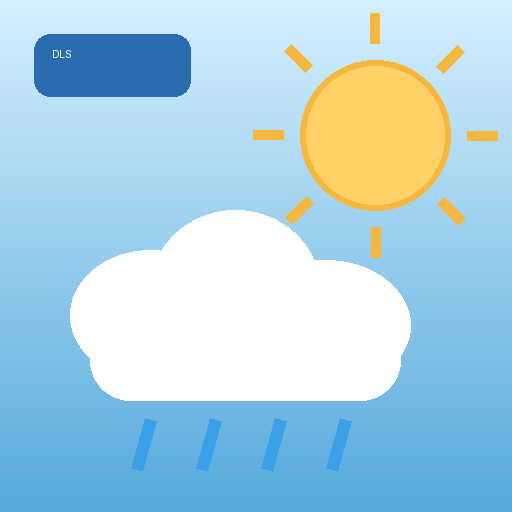

# 动态生活天气助手（DLS Weather Assist）

给 [`astrbot_plugin_dynamic_life_state`](https://github.com/Hola-Gracias/astrbot_plugin_dynamic_life_state)
用的辅助插件：**按你设置的城市，每天定时联网获取真实天气，写进 AstrBot「扩展功能 → 每日日程」的天气面板和当天状态。**

不需要天气 API Key，天气数据来自 [Open-Meteo](https://open-meteo.com/)。



## 它解决什么问题

`astrbot_plugin_dynamic_life_state`（下称 DLS）自带一套按月份和日期生成的“季节模拟天气”。
它很适合让 Bot 的日程、穿搭保持稳定，但天气不是真实的。

这个插件补上真实天气这一环：

- 每天定时拉取目标城市的真实预报；
- 把 24 小时预报压缩成 DLS 需要的 **8 个自然时段**：凌晨、早上、上午、中午、下午、傍晚、晚上、深夜；
- 写入 DLS 的天气覆写存储，并更新“今天”已有日程里的天气字段；
- 打开「扩展功能 → 每日日程」就能看到真实天气，DLS 生成日程时也会按真实天气来安排活动与穿搭。

## 功能

- **按城市或经纬度定位**：城市名走 Open-Meteo 地理编码，也可以直接填 `39.9042,116.4074`。
- **每天定时同步**：默认 `23:30`，正好赶在 DLS `00:00` 生成第二天日程之前，把明天的天气准备好。
- **启动补齐**：AstrBot 启动或插件重载后，立即补齐今天和明天的天气，避免关机错过定时。
- **写入「每日日程」**：直接调用 DLS 的天气存储；DLS 没运行时退化为写 `weather_overrides.json`，重载后生效。
- **可选重排今日日程**：开启后，更新今天天气时让 DLS 重新生成今日日程（会消耗 LLM token，默认关闭）。
- **聊天内改位置**：`/天气日程 位置 上海`，不用每次开面板。
- **状态可查**：`/天气日程 状态` 能看到上次同步、下次运行、DLS 连接状态。
- **无 Key、无遥测**：只向你配置的城市对应的 Open-Meteo 接口发请求。

## 工作流程

```text
每天 23:30（可配置）
  │
  ├─ 1. 地理编码：城市名 → 经纬度
  ├─ 2. Open-Meteo：拉取未来 3 天逐小时预报
  ├─ 3. 映射：24 小时 → 8 个自然时段（天气现象、气温、降水概率、风力）
  │
  ├─ DLS 正在运行
  │    ├─ weather_store.set(明天, 8 个时段)
  │    └─ 若目标是今天：同时更新今日日程里的天气字段
  │
  └─ DLS 未运行
       └─ 写 weather_overrides.json，等 DLS 重载后读取

次日 00:00
  │
  └─ DLS 生成当天日程，读取刚才写入的真实天气
```

这样安排的好处是：**不需要在生成日程后再改一遍**。23:30 写入明天，00:00 DLS 生成“今天”（也就是刚写好的明天）时直接使用真实天气。

## 安装

### 前置条件

- AstrBot `>= 4.29.0, < 5`（开发测试于 4.29.4）
- 已安装并启用 `astrbot_plugin_dynamic_life_state`（DLS）
- 能访问 `api.open-meteo.com` 和 `geocoding-api.open-meteo.com`

### 方式一：面板安装（推荐）

1. 从 [Releases](https://github.com/fish/astrbot_plugin_dynamic_lifestyle_weather_assist/releases)
   下载 `astrbot_plugin_dynamic_lifestyle_weather_assist.zip`。
2. 打开 AstrBot 面板 → **插件** → **从文件安装**，选择 zip。
3. 安装完成后，在插件列表找到「动态生活天气助手」，打开配置，确认城市和同步时间。
4. 保存配置（AstrBot 会自动重载插件）。

### 方式二：手动放目录

把整个插件文件夹放到：

```text
~/.astrbot/data/plugins/astrbot_plugin_dynamic_lifestyle_weather_assist/
```

Windows 桌面版通常是：

```text
C:\Users\<你的用户名>\.astrbot\data\plugins\astrbot_plugin_dynamic_lifestyle_weather_assist\
```

然后在面板里重载插件或重启 AstrBot。

### 首次使用三步

1. 在插件配置里把「地理位置」改成你的城市（默认是 `北京`）。
2. 确认「每日同步时间」是 `23:30`，「同步目标」是「只同步明天（推荐）」。
3. 在聊天里发送 `/天气日程 刷新`，或等下一次定时同步；然后打开
   **扩展功能 → 每日日程** 查看天气。

## 配置

在 AstrBot 面板 → 插件 → 动态生活天气助手 → 配置中修改。

| 配置项 | 默认值 | 说明 |
| --- | --- | --- |
| `location` | `北京` | 城市名（`北京`、`上海`）或坐标（`39.9042,116.4074`）。留空且无经纬度时不会同步。 |
| `latitude` / `longitude` | `0` / `0` | 可选。两项都填时直接使用坐标，跳过城市地理编码；填 `0` 表示不启用。 |
| `country_code` | `CN` | 地理编码优先选择的国家/地区；留空不限制。 |
| `update_time` | `23:30` | 每日同步时间，24 小时制 `HH:MM`。 |
| `target` | `tomorrow` | `tomorrow` 只同步明天；`today` 只同步今天；`both` 今天和明天。 |
| `sync_on_start` | `true` | 启动/重载后立即补齐今天和明天的天气（只更新天气，不重排日程）。 |
| `regenerate_today` | `false` | 定时/手动同步更新今天天气后，是否让 DLS 重排今日日程（消耗 LLM token）。 |
| `timezone` | `Asia/Shanghai` | 调度和日期计算使用的时区。DLS 固定使用上海时区，通常不要改。 |
| `request_timeout` | `20` | 单次网络请求超时（秒）。 |
| `retry_count` | `3` | 天气请求最大尝试次数。 |
| `debug_mode` | `false` | 输出更多日志。 |

> 提示：如果你把同步时间改到早上（例如 `07:00`），建议把 `target` 改成 `today` 或 `both`，
> 并在需要日程跟着天气变化时打开 `regenerate_today`。

## 指令

所有指令都需要 AstrBot 管理员权限。

| 指令 | 说明 |
| --- | --- |
| `/天气日程 刷新` | 立即按当前配置同步一次。 |
| `/天气日程 刷新 今天` | 只同步今天（也可写 `明天`、`全部`、`today`、`tomorrow`、`both`）。 |
| `/天气日程 状态` | 查看位置、调度、下次运行、上次同步结果和 DLS 连接状态。 |
| `/天气日程 位置` | 查看当前位置。 |
| `/天气日程 位置 上海` | 校验并保存临时位置，立即生效。 |
| `/天气日程 位置 39.9042,116.4074` | 直接用经纬度。 |
| `/天气日程 位置 重置` | 清除聊天里设置的临时位置，恢复插件配置。 |
| `/天气日程 帮助` | 显示帮助。 |

英文别名：`/weathersync ...`、`/wxs ...`。

## 天气映射规则

### 8 个自然时段

| 时段 | 时间范围 | 气温取值 |
| --- | --- | --- |
| 凌晨 | 00:00–06:00 | 时段内最低温 |
| 早上 | 06:00–09:00 | 时段内平均温 |
| 上午 | 09:00–12:00 | 时段内平均温 |
| 中午 | 12:00–14:00 | 时段内最高温 |
| 下午 | 14:00–18:00 | 时段内最高温 |
| 傍晚 | 18:00–20:00 | 时段内平均温 |
| 晚上 | 20:00–23:00 | 时段内平均温 |
| 深夜 | 23:00–24:00 | 时段内最低温 |

### 天气现象

Open-Meteo 的 WMO 天气代码会转换成 DLS 认识的中文天气：

| WMO 代码 | 中文 |
| --- | --- |
| 0、1 | 晴 |
| 2 | 多云 |
| 3 | 阴 |
| 45、48 | 雾 |
| 51、53、61 | 小雨 |
| 55、63、81 | 中雨 |
| 65、82 | 大雨 |
| 56、57、66、67 | 冻雨 |
| 71、77、85 | 小雪 |
| 80 | 阵雨 |
| 73、86 | 中雪 |
| 75 | 大雪 |
| 95、96、99 | 雷阵雨 |

一个时段内只要出现降水，就优先显示降水天气；多种降水同时出现时取较重的一种。
降水概率取该时段内的最大值，风力按平均风速换算成蒲福风级（如 `东南风 3级`）。

### 和 DLS 的衔接

- DLS 的天气结构是 `time / condition / temperature / precipitation / precipitation_probability / wind`，
  插件输出的 8 个时段严格使用这些字段。
- 写入后 DLS 会自己重新计算当天概览（如 `晴转多云，3~12℃，西北风 2级`）和季节标签。
- 插件不修改日程文本；是否按新天气重排由 `regenerate_today` 决定。
  即使不重排，每日日程页面里的“天气”面板和每个时段的天气标签也会立即更新。

## 数据与隐私

插件只保存以下本地数据（都在 AstrBot 的 `data/plugin_data/` 下）：

```text
data/plugin_data/astrbot_plugin_dynamic_lifestyle_weather_assist/
├── settings.json   # 聊天里设置的位置（如果有）
└── state.json      # 最近同步结果，最多保留 10 条
```

- 不会上传任何数据到第三方，除了向 Open-Meteo 发送你配置的经纬度以获取天气。
- 不需要注册，不需要 API Key。
- `settings.json` 和 `state.json` 已被 `.gitignore` 排除，不会误提交到 GitHub。

## 目录结构

```text
astrbot_plugin_dynamic_lifestyle_weather_assist/
├── main.py                 # AstrBot 插件入口：调度、指令、编排
├── core/
│   ├── config.py           # 配置解析与位置优先级
│   ├── location.py         # Open-Meteo 地理编码
│   ├── open_meteo.py       # 逐小时预报客户端与解析
│   ├── mapping.py          # 24 小时 → 8 时段、WMO 中文映射、风力
│   ├── dls.py              # 定位 DLS、写入天气、可选重排
│   └── store.py            # 原子 JSON 存储
├── tests/                  # 离线单元测试
├── docs/
│   ├── DESIGN.md           # 设计、数据流、兼容性契约
│   └── 上传GitHub.md        # 推送到 GitHub 的步骤
├── _conf_schema.json       # AstrBot 配置页
├── metadata.yaml
├── requirements.txt
├── logo.png
├── README.md
├── CHANGELOG.md
└── LICENSE
```

## 开发与测试

```bash
# 离线单元测试（不需要 AstrBot 在运行）
python -m unittest discover -s tests -t . -v
```

如果你想单独验证联网取数：

```python
import asyncio, datetime
from core.location import resolve_location
from core.open_meteo import fetch_forecast
from core.mapping import aggregate_day

async def main():
    loc = await resolve_location("北京")
    forecast = await fetch_forecast(
        loc.latitude, loc.longitude, timezone="Asia/Shanghai"
    )
    today = aggregate_day(forecast, datetime.date.today())
    print(loc.display, today.summary)
    print(today.to_dls_slots())

asyncio.run(main())
```

## 常见问题

**城市找不到 / 选了错误的同名城市？**

改用经纬度，或在配置里写更完整的名称。Open-Meteo 的地理编码对中文城市支持良好，
但同名地点不少，建议直接填坐标。

**每日日程里还是原来的模拟天气？**

1. 发 `/天气日程 状态`，确认「每日日程插件」显示“已连接”；
2. 确认日期是今天或明天（历史日期只读，不会改）；
3. 发 `/天气日程 刷新` 立即同步；
4. 如果 DLS 是刚装的，重载一次 DLS 再刷新。

**天气变了，日程文字没变？**

这是 DLS 的设计：改天气不会自动重排已有日程。两种办法：

- 打开配置里的 `regenerate_today`，之后定时/手动同步今天天气时会重排；
- 或手动发 `/dls regen` 让 DLS 重新生成。

**23:30 时机器关着怎么办？**

`sync_on_start` 会在 AstrBot 启动后补齐今天和明天的天气。如果当天的日程已经用模拟天气生成过，
天气面板会更新，但日程文字不会自动重排；需要时打开 `regenerate_today` 后手动 `/天气日程 刷新`。

**会消耗 LLM token 吗？**

只在 `regenerate_today` 开启、且同步的是“今天”时才会调用 DLS 的 LLM 重排。
默认关闭，纯天气同步不调用 LLM。

**需要代理吗？**

插件使用 `aiohttp` 并开启 `trust_env`，会读取 `HTTPS_PROXY` / `HTTP_PROXY` 环境变量。
如果 Open-Meteo 直连不稳定，可以给 AstrBot 进程设置代理环境变量。

**支持哪些 AstrBot 平台？**

插件不依赖具体消息平台；指令只要求 AstrBot 管理员权限。`metadata.yaml` 里列出了常见的支持平台。

## 上传到 GitHub

仓库已按独立插件整理好（README、LICENSE、CHANGELOG、测试、CI）。
具体步骤见 [docs/上传GitHub.md](docs/上传GitHub.md)。

## License

[MIT](LICENSE)